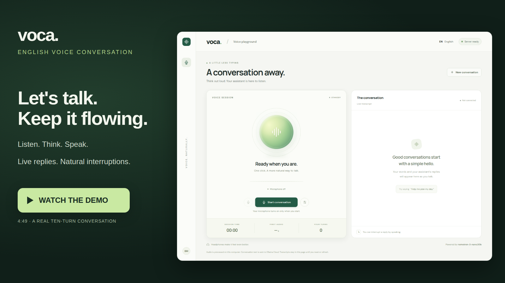
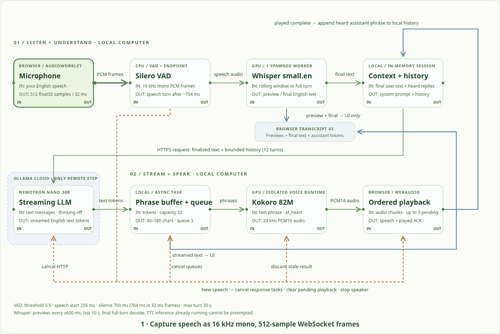
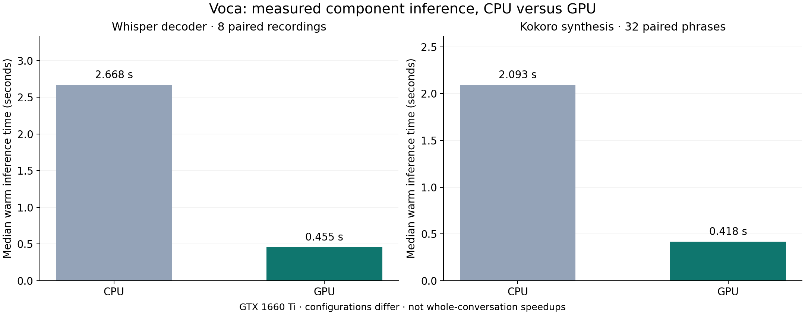
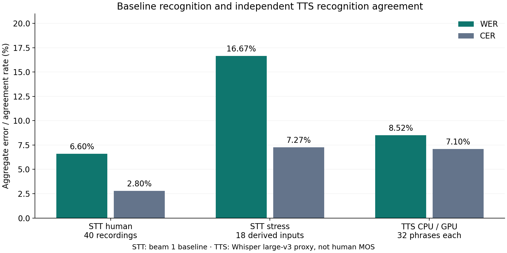

# Voca — English voice conversation

A local voice playground that lets you talk naturally with an AI assistant. Your microphone feeds English speech recognition, Ollama Cloud streams the conversation response, and local text-to-speech speaks it back in short phrases. Speak during an answer to interrupt it.

Built by **Bola Maged Ramses Nessim**.

[](https://bmaged23.github.io/voice-conversation/demo.html)

The demo follows a ten-turn birthday-picnic planning conversation with a real interruption, with a synthesized demo-user voice and live assistant responses. No narrated walkthrough or mocked replies. See [recording details](docs/demo/README.md).

The recording uses the earlier Nemotron configuration. The current default is Gemma 4 31B, selected using the measured reasoning comparisons below.

The video player and interactive diagram are hosted with GitHub Pages. You can also open them locally as described under [Sharing the demo](#sharing-the-demo).

## Voice pipeline — inputs and outputs

[](https://bmaged23.github.io/voice-conversation/architecture.html)

**[Open the interactive animated diagram](https://bmaged23.github.io/voice-conversation/architecture.html)** — connected entities, input/output arrows, streaming data packets, playback acknowledgments and interruption control.

1. **Capture:** the browser captures your microphone, requests echo cancellation and noise suppression, and sends 16 kHz mono audio in 512-sample frames over a local WebSocket.
2. **Detect:** Silero VAD on the CPU distinguishes speech from silence. The initial end-of-turn threshold is 700 ms of silence; a turn is capped at 30 seconds.
3. **Transcribe:** a GPU faster-whisper worker produces rolling previews, then decodes the full turn. Previews stay local; only finalized transcripts go to the LLM.
4. **Converse:** Gemma 4 31B runs on Ollama Cloud with streaming enabled, thinking disabled, bounded history and short English responses.
5. **Speak:** streamed text is buffered into short phrases. An isolated GPU Kokoro worker synthesizes them while earlier audio plays in the browser. Bounded queues prevent unlimited buffering; CPU synthesis remains configurable.
6. **Interrupt:** confirmed new speech cancels the response, clears queued audio and stops playback. A short inference already running may finish internally, but its stale output is ignored. History retains only fully played assistant phrases.

This is a modular STT → LLM → TTS pipeline. Whisper uses rolling windows rather than a native streaming decoder; Kokoro streams at phrase boundaries rather than generating partial waveforms inside each phrase.

## What you get

- Responsive voice interface with an animated orb, live audio activity, transcripts, response timing and interrupted-reply markers.
- Browser microphone selection, mute, assistant volume and conversation reset.
- Separate spawned speech processes with models kept loaded and warmed before the server becomes ready.
- One configuration file: [`config.py`](config.py). Private credentials stay in `.env`.
- Exact main environment snapshot in [`requirements.txt`](requirements.txt) and an isolated [GPU voice environment](requirements/tts-gpu.txt).
- Offline tests, actual speech smoke tests, browser checks and a reproducible demo recorder.

## Evaluation and API





The [evaluation report](docs/evaluation/README.md) records frozen cases, baseline failures,
CPU/GPU comparisons and limitations. Kokoro's paired 32-phrase generation benchmark
improved from **2.093 s on CPU to 0.418 s on GPU**; this is synthesis timing, not a
fivefold whole-conversation speedup. Independent recognition returned identical
transcripts for every paired CPU/GPU output. The original 40-recording STT baseline
scored **6.60% WER / 2.80% CER** with beam 1; the qualified beam-3 image scored
**6.60% WER / 2.64% CER** on the same human references.

The FastAPI backend provides readiness/configuration/diagnostic HTTP endpoints and
`WS /ws` for streaming microphone input, recognized text, cloud replies, speech and
playback acknowledgements. See the [API README](docs/api/README.md) for endpoints,
audio formats and the single-session local scope.

GitHub [offline CI](.github/workflows/tests.yml) runs the pinned installation and unit
tests on pushes and pull requests. The [GPU release workflow](docs/deployment/README.md) passed hosted build, actual GPU qualification, Docker Hub publication and anonymous public startup verification. A previous arithmetic regression correctly blocked publication before the model change.

### Qualified GPU image results

| Check | Measured result |
| --- | --- |
| Offline regressions / microphone transport | **14/14** tests; 80 queued frames delivered in order |
| Cloud reasoning regressions | **8/8** required answers |
| Silero clip activation | **58/58** speech/stress detected; **0/6** non-speech activations |
| STT | **64/64** executions; 40 human recordings: **6.60% WER / 2.64% CER** |
| TTS | **32/32** generations/audits; independent recognition agreement **8.52% WER / 7.10% CER** |
| Connected browser dialogue | **19/21** passed; zero JavaScript errors |
| First audio after recording ended | **1.99 s median**, **6.18 s p95**, 19 audio-producing turns |
| Backend RAM / whole-device VRAM | Sampled peaks **1,828 MiB / 1,747 MiB** |
| Backend CPU | Mean **110%**, peak **351%**, where 100% is one logical core |

Two affect/effect teaching turns remain known limitations. TTS recognition agreement is a proxy, not human listening quality. These are small development suites on one GTX 1660 Ti; sampling can miss peaks. The 31B LLM runs on Ollama Cloud, so its hardware is excluded from local CPU/RAM/VRAM figures. See the [complete report and immutable release evidence](docs/evaluation/README.md).

## Requirements

| Item | Supported / tested setup |
| --- | --- |
| Operating system | Linux x86_64 or WSL2 with GPU access |
| Python | **3.12** |
| GPU | NVIDIA CUDA-capable GPU; tested on **GTX 1660 Ti, 6 GB VRAM** |
| Memory | Approximately 7.7 GiB RAM was visible in the test environment |
| Browser | Current Chromium/Chrome/Edge; microphone access through localhost |
| Cloud | Ollama API key, access to the selected model, and internet connectivity |
| Disk | Speech assets approximately 804 MiB, plus the environment/CUDA packages; allow several GB |

The exact requirements snapshot includes Linux CUDA libraries and development/recording tools. It is not a universal Windows/macOS dependency set. Native Windows and macOS have not been validated. An Ollama installation is **not** required for direct cloud API calls. FFmpeg and Playwright Chromium are needed only to reproduce documentation media, not for normal conversation.

## Run the prebuilt GPU image

**[Public Docker Hub image](https://hub.docker.com/r/bmaged23/voice-conversation)** · [Passing release workflow](https://github.com/bmaged23/voice-conversation/actions/runs/40223674458)

With NVIDIA GPU support enabled in Docker, create a local `.env` containing:

```dotenv
OLLAMA_API_KEY=your_own_key
OLLAMA_BASE_URL=https://ollama.com
OLLAMA_MODEL=gemma4:31b
```

```bash
docker pull bmaged23/voice-conversation:gpu
docker run --rm --gpus all --env-file .env \
  -p 127.0.0.1:8765:8765 \
  bmaged23/voice-conversation:gpu
```

After warmup, open **http://localhost:8765** and allow microphone access. The image includes production speech assets and both runtime environments; this route needs neither Git nor a model download on startup. Your Ollama account needs access and allowance for the selected cloud model. The browser handles microphone/speaker access. Stop with Ctrl+C.

The qualified Linux amd64 image is approximately **3.00 GB compressed** in the registry and reports **8.51 GB** locally, down from **11.9 GB** before sharing CUDA libraries. Allow at least **15 GiB free disk space** for pull/unpacking and working headroom. The tested GPU has 6 GiB VRAM. [Container and release details](docs/deployment/README.md).

For an immutable pull, use:

```bash
docker pull bmaged23/voice-conversation@sha256:60fe05514e98ac477de8a4a9935f2ab61c6d9f880fd25c37c6c5fda94bfdc7f3
```

## Clone and run from source

### 1. Clone the repository

Clone the repository:

```bash
git clone https://github.com/bmaged23/voice-conversation.git voice-conversation
cd voice-conversation
```

If you already have the project folder, open a terminal there instead.

### 2. Create the project environment and install exact dependencies

```bash
python3.12 -m venv .venv
source .venv/bin/activate
python -m pip install --upgrade pip
python -m pip install -r requirements.txt
python -m pip check
```

`requirements.txt` pins all installed distributions, including transitive dependencies, CUDA libraries, testing and browser-recording tools. Its final `-e .` installs this checkout as an editable package; it contains no machine-specific source path.

Create the isolated CUDA voice environment too. The two environments use different ONNX/CUDA dependencies to keep VAD/STT and GPU TTS compatible:

```bash
python3.12 -m venv .venv-tts-gpu
.venv-tts-gpu/bin/python -m pip install --upgrade pip
.venv-tts-gpu/bin/python -m pip install --no-deps -r requirements/tts-gpu.txt
```

The GPU voice environment intentionally replaces the CPU ONNX distribution required by Kokoro metadata. Do not install both ONNX distributions into it. CUDA runtime libraries are also supplied by the main environment; keep both environments beside this checkout. The archived `requirements/archive/uv-original.lock` does not describe this two-environment setup; use the pinned files above.

### 3. Configure Ollama Cloud

```bash
cp .env.example .env
chmod 600 .env
```

Edit `.env` locally:

```dotenv
OLLAMA_API_KEY=YOUR_OLLAMA_API_KEY
OLLAMA_MODEL=gemma4:31b
OLLAMA_BASE_URL=https://ollama.com
```

Create a key at [Ollama](https://ollama.com/settings/keys). Select a model available to your account. Cloud requests consume your plan allowance or applicable usage charges. Do not commit `.env` or put the key into browser JavaScript. Environment variables override `.env` values.

### 4. Download the speech models

```bash
HF_HOME="$PWD/.cache/huggingface" python -m scripts.setup.download_speech_models
```

This downloads:

| Component | Artifact |
| --- | --- |
| English STT | `Systran/faster-whisper-small.en` |
| Voice detection | Silero VAD ONNX |
| English TTS | Kokoro v1.0 ONNX and voice embeddings |

The downloader uses the checked-in [model manifest](docs/assets/model-manifest.json) as its initial revision reference and writes the local manifest to `models/assets.json`. It verifies available release checksums and records SHA256 hashes. Model weights and caches are excluded from Git.

### 5. Check configuration, GPU and speech

```bash
python -m scripts.validation.validate_configuration
nvidia-smi
python -m scripts.application.start_voice_app -m scripts.validation.validate_speech_models
```

The speech check synthesizes a sample sentence, runs Silero detection and transcribes it with the configured GPU STT model. It writes a synthetic WAV and report under ignored `logs/`. The launch helper adds the environment's NVIDIA library directories for CTranslate2.

To test cloud authentication with a short request:

```bash
python -m scripts.validation.validate_cloud_connection
```

This sends real requests and consumes a small amount of cloud allowance.

### 6. Start Voca

```bash
python -m scripts.application.start_voice_app
```

Open **http://localhost:8765**, click **Start conversation**, and allow microphone access. Use headphones initially. Say “Can you help me plan my day?”, pause for a reply, then speak during the reply to test interruption.

- **Mute:** stops your microphone audio from reaching the conversation while you listen.
- **Audio settings:** select a microphone for the next session and adjust playback volume.
- **End conversation:** stops capture and playback.
- **New conversation:** stops the session and clears the displayed transcript. Starting a session creates fresh server history.

Stop the server with **Ctrl+C**. Restart it after changing `config.py`. On WSL2, open localhost in your desktop browser and keep Python in WSL; Python does not need a directly exposed `/dev/snd` device.

## Configuration

All runtime tuning lives in [`config.py`](config.py). See the complete [parameter reference](docs/parameters.md).

| Setting | Default |
| --- | --- |
| STT | `small.en`, CUDA device 0, `int8_float32`, beam size 3 |
| STT preview | Every 600 ms when the worker is available; latest 10 seconds |
| VAD | Threshold 0.5; configured minimum speech 200 ms |
| End of turn | 700 ms silence |
| Interruption | Enabled; effective minimum speech 256 ms |
| TTS | Isolated CUDA runtime, `af_heart`, speed 1.05 |
| Phrase sizes | 40–180 characters; safe-boundary flush timeout 350 ms |
| LLM | Streaming, thinking off, temperature 0, maximum 192 response tokens |
| Cloud deadlines | 15 seconds to first content; 15 seconds between content updates |
| Speech workers | 1 STT process; 1 TTS coordinator with an isolated GPU voice process |
| Queues | 3 TTS phrases; 3 playback chunks; 32 streamed text items |
| Microphone buffering | 64 KiB WebSocket buffer; up to 125 queued frames; poll every 8 ms |
| Concurrency | 1 browser session, 1 web worker |
| Logging | INFO; live audio and transcript recording disabled |

The 700 ms threshold is evaluated in 32 ms frames, so it is reached at approximately 704 ms. Increasing process counts loads additional model copies; it does not automatically reduce latency. Separate ONNX environments keep GPU TTS compatible with the CPU VAD and GPU STT libraries. Provider labels identify implemented adapters and cannot switch backends by themselves.

CPU-only **Linux** experimentation can use the main environment and set `CONFIG['stt']['device']='cpu'`, its `compute_type='int8'`, and `CONFIG['tts']['device']='cpu'`. This alternative does not need the GPU voice environment. Component CPU timings are reported separately; the release image targets NVIDIA GPU use.

## Verification

```bash
python -m pytest -q
python -m scripts.application.start_voice_app -m scripts.validation.validate_speech_models
# With the voice server running; sends one real cloud request:
python -m scripts.validation.validate_voice_session
```

The 14 offline tests cover phrase buffering, VAD endpointing, playback backpressure/order, immediate interruption, cloud content deadlines, malformed controls, audio framing, origin/session rejection and Kokoro input compatibility. The synthetic session test exercises real STT, cloud streaming and TTS, but simulates browser playback acknowledgments. See the [evaluation report](docs/evaluation/README.md) for frozen human/component and real-browser conversation suites.

Optional browser checks:

```bash
python -m playwright install chromium
python -m scripts.validation.validate_browser_interface
python -m scripts.validation.validate_microphone_transport
```

Browser checks use synthetic events and do not call the LLM. Physical microphone quality, acoustic echo and perceived conversation latency still need testing on your device. Timing examples are smoke-test observations, not a general latency or accuracy benchmark.

## Project layout

```text
voice-conversation/
├── config.py                   Runtime settings, thresholds and worker counts
├── .env.example                Safe credential template
├── requirements.txt            Exact installed environment snapshot
├── pyproject.toml              Package metadata
├── requirements/               GPU voice pins and historical lock archive
├── deployment/docker/          Complete GPU image recipe
├── .github/workflows/          Offline/browser CI and gated image delivery
├── evaluation/                 Frozen datasets and explicit release thresholds
├── src/voice_conversation/
│   ├── server.py               WebSocket session and streaming orchestration
│   ├── core.py                 Phrase buffering and endpoint detection
│   ├── workers.py              Speech adapters and Silero ONNX
│   ├── gpu_voice.py            Isolated persistent CUDA voice process
│   └── settings.py             Config loading and private environment settings
├── web/                        Browser UI, audio capture and playback
├── scripts/                    Setup, application, evaluation, release, validation and media tools
├── tests/                      Offline regression tests
├── docs/
│   ├── architecture.html       Interactive animated architecture
│   ├── assets/                 Animated diagram and model revision manifest
│   ├── api/                    HTTP and streaming protocol documentation
│   ├── evaluation/             Measured results, charts and limitations
│   ├── deployment/             Release stages and GPU qualification
│   ├── notices/                Upstream model/runtime notices
│   ├── demo.html               Standalone video player
│   └── demo/                   MP4, poster, transcript and recording notes
├── models/                     Downloaded models (ignored)
├── logs/                       Local test recordings and reports (ignored)
├── .venv/                      Main environment (ignored)
└── .venv-tts-gpu/              Isolated GPU voice environment (ignored)
```

## Sharing the demo

With the app running, open **http://localhost:8765/docs/demo.html** for the video player or **http://localhost:8765/docs/architecture.html** for the animated diagram. These documentation pages work without the API when served as static files:

```bash
python -m http.server 8080 --directory docs
# Open http://localhost:8080/demo.html
```

For a hosted player like the fitness repository, push the reviewed project to GitHub, then choose **Settings → Pages → Deploy from a branch → your branch → /docs**. The player will be at:

```text
https://bmaged23.github.io/voice-conversation/demo.html
```

The demo player is hosted at the URL above. The MP4, poster and GIF are ordinary tracked files; runtime models, credentials and raw recording frames remain ignored. See [recording/reproduction notes](docs/demo/README.md).

To reproduce the real conversation recording:

```bash
# Install system ffmpeg/ffprobe and Playwright Chromium first.
# Keep the voice server running in another terminal.
python -m scripts.demo.record_conversation_demo
python -m scripts.documentation.render_pipeline_animation
```

The recording helper generates a synthetic user voice, drives the actual browser microphone pipeline, records the screen and reconstructs the digital audio mix from actual playback buffers and start/stop timestamps, and writes an H.264/AAC MP4 plus a VP9/Opus WebM fallback and machine-generated captions. It makes ten live cloud requests. It does not publish anything.

To refresh exact requirements after deliberately changing the environment:

```bash
python -m scripts.dependencies.export_installed_versions
```

## Troubleshooting

| Problem | Action |
| --- | --- |
| Python version conflict | Create `.venv` with Python 3.12. Do not reuse a Python 3.14 environment. |
| Missing model files | Run `scripts/setup/download_speech_models.py` before starting the server. |
| CUDA/cuDNN library error | Check `nvidia-smi`, use `scripts/application/start_voice_app.py`, and verify your NVIDIA driver supports the installed CUDA 12 libraries. |
| No microphone permission | Use localhost, allow microphone access, and check the device in audio settings. |
| Assistant interrupts itself | Use headphones; browser echo cancellation depends on your device. |
| Replies start too early | Increase `vad.end_of_turn_silence_ms`. |
| Replies feel slow | Inspect measured first-audio latency; tune STT size, phrase lengths and cloud model. Do not add workers blindly. |
| Cloud authentication/quota error | Verify `.env`, account model access and Ollama usage allowance. |
| Another session is active | Stop/close the other conversation tab first. |
| Port 8765 is occupied | Stop the existing server or change `server.port` in `config.py`. |

## Data handling and model sources

Live microphone audio and synthesized speech remain local. Finalized transcripts and bounded conversation history are sent to Ollama Cloud. The application keeps live history in memory and does not save user recordings/transcripts by default. The tracked demo uses only synthetic user speech and its actual generated replies.

This is a prototype with silence-based endpointing, conservative completed-phrase history, and one active session. It does not include semantic turn detection, word-level playback alignment, external task tools or a guaranteed echo-cancellation system.

- [Ollama Cloud API](https://docs.ollama.com/cloud)
- [Gemma 4](https://ollama.com/library/gemma4)
- [faster-whisper](https://github.com/SYSTRAN/faster-whisper) · [English Small checkpoint](https://huggingface.co/Systran/faster-whisper-small.en)
- [Silero VAD](https://github.com/snakers4/silero-vad)
- [Kokoro ONNX](https://github.com/thewh1teagle/kokoro-onnx) · [Kokoro model](https://huggingface.co/hexgrad/Kokoro-82M)

Respect each upstream component's license and attribution requirements when redistributing artifacts. No CALLHOME or other licensed telephone dataset is included in this project.
