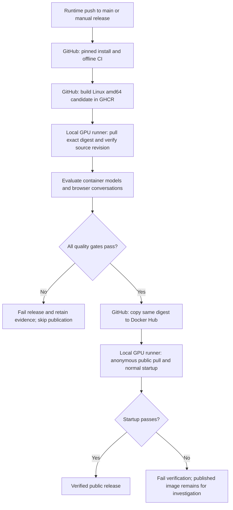

# CI/CD — GPU container build, evaluation and publication

The image recipe is [`deployment/docker/Dockerfile`](../../deployment/docker/Dockerfile).
It packages both isolated Python environments, production speech models, browser UI,
API and upstream notices. It does not package credentials, user recordings, local
memory or the independent evaluation model.

## End-to-end flow



| Stage / workflow job | Runs on | What happens |
| --- | --- | --- |
| CI / `tests` | GitHub-hosted Ubuntu | Install Python3.12.15 and pinned requirements, run `pip check`, offline tests and Chromium microphone ordering/overflow checks. |
| Candidate / `build` | GitHub-hosted Ubuntu | Build the complete Linux amd64 GPU image and stage it in GHCR. Record its immutable digest and source revision. |
| Evaluation / `qualify` | Trusted local `voca-gpu` runner | Pull that digest, verify its revision, and exercise the container with the real GPU and frozen local fixtures. |
| Publication / `publish` | GitHub-hosted Ubuntu | After qualification, copy the exact digest to public Docker Hub tags `gpu` and `sha-<commit>`, verify manifest identity and update the Hub overview. |
| Distribution / `verify_public` | Trusted local `voca-gpu` runner | Pull the published digest without Docker Hub login and check normal GPU startup and readiness. |

The exact-container qualification includes offline tests, **10 interpretation
controls**, **8 cloud reasoning cases**, VAD on **64 clips**, STT on **64 recordings**,
and **32 TTS phrases**. A separate local Whisper large-v3 process independently
recognizes the saved TTS audio. Chromium then exercises **21 connected microphone
turns** against the candidate container. Resource sampling records container CPU,
RAM and whole-device GPU usage during the browser phase.

The [release policy](../../evaluation/release_policy.json) defines the required
counts and error-rate thresholds. The [evaluation README](../evaluation/README.md)
explains scoring and measured results. Evaluation happens **before Docker Hub
publication**, against the built candidate image. Public startup verification
happens **after publication**. A post-publication verification failure marks the
workflow failed but does not automatically roll back the Docker Hub tag.

CD here means delivery of a qualified public image. The workflow does not update
or restart a user's running application; use the main README's
[pull/run instructions](../../README.md#run-the-prebuilt-gpu-image).

## Triggers and runner requirements

- **Every push and pull request:** the separate [Tests workflow](../../.github/workflows/tests.yml) runs offline installation, unit and microphone transport checks.
- **Runtime changes on `main`:** the [GPU release workflow](../../.github/workflows/release.yml) runs for its configured source, UI, configuration, dependency, test, evaluation and packaging paths. The build is restricted to the owner on this repository's `main` branch.
- **Manual release:** use Actions → GPU image release → Run workflow on `main`; this is also needed when workflow-only maintenance should qualify a new image.
- **Documentation-only changes:** run offline CI without rebuilding or republishing the image. The model asset manifest is an explicit release-triggering exception.

The laptop must be awake, NVIDIA GPU access and Docker/WSL integration working,
and the registered `voca-gpu` runner online. Otherwise GPU jobs wait for that
runner. GitHub-hosted machines cannot access its GPU or frozen private waveforms.
The local runner attaches existing evaluation recordings and the independent audit
model; these private assets are not bundled into the public image. Cloud access
and account allowance are needed for reasoning, interpretation and conversation
checks. Missing prerequisites or provider failures prevent a successful release.

## Credentials and evidence

GitHub's scoped `GITHUB_TOKEN` authenticates GHCR access. Repository secrets
`OLLAMA_API_KEY` and `DOCKERHUB_TOKEN` supply cloud evaluation and Docker Hub
publication access. Credentials are injected at runtime and are not embedded in
the image. Pull requests use offline CI without these cloud/publication secrets.

The `voca-gpu-qualification` workflow artifact contains aggregate gate results and
container resource summaries, retained for 30 days. Raw recordings, dialogues and
stage outputs stay in the private laptop archive, grouped by run ID and attempt.
Failed evaluation evidence is retained when available. A failure before the
aggregate is written can leave that artifact incomplete; inspect the failing job's
logs and private outputs as well. The
[verified release run](https://github.com/bmaged23/voice-conversation/actions/runs/40248465601)
shows all stages passing.

## Quality scope

All **21 original conversation turns** must pass, including teaching clarification
and follow-up examples. All **10 interpretation controls** must pass with zero
unwanted changes. A failed case blocks publication; teaching exemptions have been
removed. Raw STT remains unchanged for display and recognition scoring; validated
clarified-word edits alone enter chat memory. These repeatedly exposed development
cases are regression checks, not an untouched benchmark. Thresholds must not be
lowered to make a candidate pass.

Only aggregate `gate-summary.json` is uploaded publicly. Audio, raw dialogues,
provider payloads and private evaluation traces stay on the laptop. Cloud calls
consume the account allowance; a failed quota/network gate prevents publication.
Documentation-only changes run offline CI without rebuilding or republishing an
unchanged image. Workflow-file maintenance requires manual release dispatch if a
new release is needed. Release concurrency queues runs rather than cancelling them.

For everyday image usage, see the dedicated [Docker README](../../deployment/docker/README.md): prerequisites, pull/run, readiness, updates and troubleshooting.

## Local build (not the prebuilt-image route)

From the repository root, with NVIDIA GPU container support:

```bash
docker build -f deployment/docker/Dockerfile \
  --build-arg VCS_REF="$(git rev-parse HEAD)" -t voca:local .
docker run --rm --gpus all --env-file .env \
  -p 127.0.0.1:8765:8765 voca:local
```

Open `http://localhost:8765`, allow microphone access and wait for readiness.
The cloud key and selected model need valid account access. Stop with Ctrl+C.
Production speech assets download at build time; model initialization happens at
startup. A release is verified only after its public pull/startup evidence exists.

## Image dependency and cache layout

Native installation uses the two exact environment snapshots. The image derives
its exact pins with `scripts.dependencies.prepare_container_requirements`, shares
CUDA/cuDNN versions from the qualified GPU voice snapshot, and keeps CPU/GPU ONNX
in separate interpreters. The generated lists are retained inside the image under
`/app/deployment/runtime-pins`. Sharing avoids duplicate large CUDA libraries;
all speech gates must pass with that image configuration before publication.

Dependency installation and production model downloads have separate cached layers.
Application-only edits no longer invalidate those large setup layers. Model setup
uses pinned revisions, direct release URLs and every reviewed file checksum; it
never silently replaces the human evaluation gold references.

Revision labels are applied after all build-time `RUN` steps so each commit's SHA
cannot invalidate cached dependency/model layers through the build environment.
See [Docker's ARG cache behavior](https://docs.docker.com/reference/dockerfile/#impact-on-build-caching).
The public startup check selects an ephemeral localhost port, so it does not need
to stop an interactive application already using port8765.
